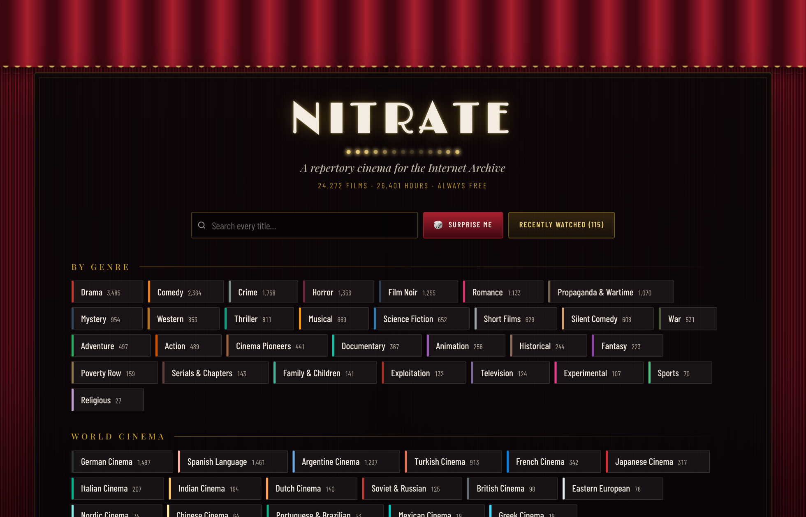
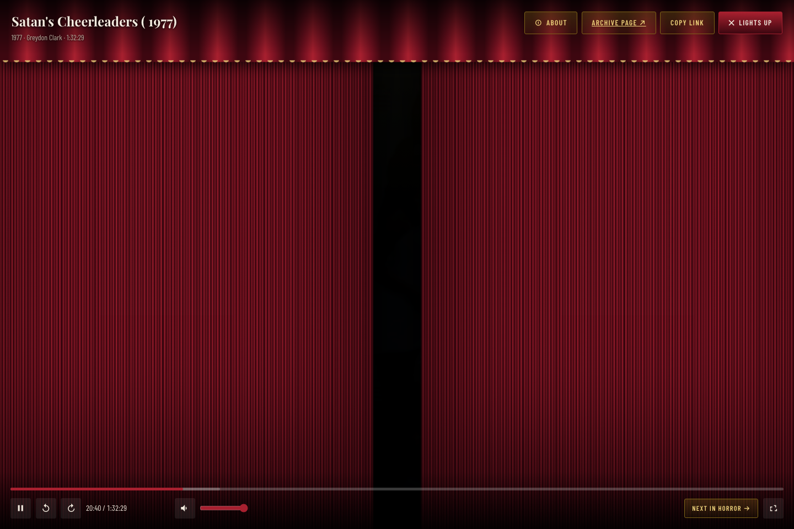
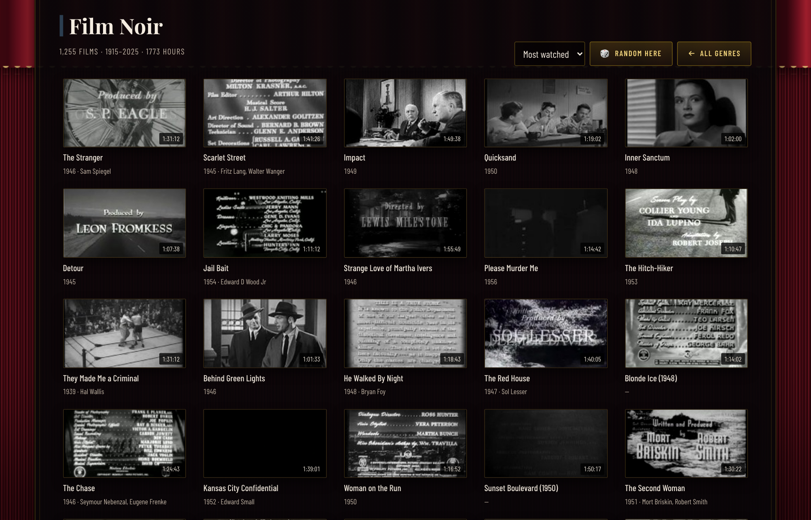

# NITRATE

**A repertory cinema for the Internet Archive.**

The Archive's [Feature Films](https://archive.org/details/feature_films) collection holds
tens of thousands of public-domain features — and browsing it is a chore. NITRATE is a
lobby for it: pick a genre, pick a title, the curtains part, and the film begins.
Nothing opens in a new tab.

**24,272 films · 26,401 hours · 64 ways in.** One self-contained HTML file.







## What it does

- **A real programme.** Every film is filed under 64 headings — genres, world cinemas,
  forms and decades — derived from the Archive's own metadata by hand-written rules.
  Anything that defies filing lands in **The Vault**, so no film is unreachable.
- **Curtains.** Choose a film and the velvet actually rolls back.
- **Random, everywhere.** A *Surprise me* button for the whole vault, a dice on every genre
  (shift-click a genre chip to jump straight into a random film from it), and *Random here*
  inside a genre.
- **It remembers.** Your place in a film is kept, so a half-watched picture resumes where you
  left it; watched titles show a progress bar in the grid.
- **Shareable.** Every genre and every film has its own link (`#/f/<archive-id>`), so you can
  send a friend straight to the picture.
- **Keyboard.** `/` search · `space` play/pause · `←/→` 10s (`shift` for a minute) · `↑/↓`
  volume · `f` fullscreen · `m` mute · `n` next · `r` random · `esc` lights up.

## Where the films come from

Everything streams **directly from archive.org**. This page stores no video, hosts nothing,
and proxies nothing — it is a menu with a projector attached. Each title links back to its
Archive item page, which is the authority on that film's rights and provenance.

The Internet Archive is a non-profit library that pays for all of the bandwidth this page
uses. If you get any pleasure out of this, [donate to them](https://archive.org/donate).

Films appear here because the Archive distributes them as public domain or under an open
licence. Rights vary by country and the Archive's item page is always the last word.
Posters, stills and metadata are the Archive's.

## Running it

`index.html` is a single self-contained file — the catalogue is baked in. Open it by
double-clicking, or serve the folder:

```sh
python3 -m http.server 8733
```

## Rebuilding the catalogue

`data/cinema-data.json` is committed, so `node build.mjs` alone rebuilds `index.html` on a
fresh clone. To regenerate the catalogue itself, the pipeline is four steps in `tools/`
(see `tools/README.md` for the details):

```sh
node tools/scrape.mjs      # page the Archive's scrape API for the collection
node tools/resolve.mjs     # per item, record every playable encode  (slow: ~2h)
python3 tools/build.py     # classify, de-duplicate, emit cinema-data.json
node build.mjs             # inline the data into index.html
```

Two things that pipeline gets right, and which are easy to get wrong:

- **Prefer the Archive's own derivatives.** A file marked `source=original` is whatever the
  uploader had, often DivX or Xvid in an `.mp4` wrapper, and browsers refuse it outright.
  The Archive's generated encodes (`h.264 IA`, `512Kb MPEG4`) are always H.264 and always
  play. The player still falls back through the remaining encodes if the first one fails.
- **No `crossorigin` on the video element.** `archive.org/download/...` answers with
  `access-control-allow-origin: *`, but the storage node it redirects to sends no CORS
  header at all — so any CORS-mode request dies. A plain media load is fine.

## Testing

Browser tests drive a headless Chrome over CDP (no npm dependencies):

```sh
python3 -m http.server 8733 &
"$CHROME" --headless=new --remote-debugging-port=9333 --user-data-dir=/tmp/nitrate-cdp &
node tools/smoke.mjs      # the whole lobby → genre → play → exit → search flow
node tools/playtest.mjs   # do the films actually decode?
```

## Credits

Built by [jtbartee](https://github.com/jtbartee). Films, posters and metadata courtesy of
the [Internet Archive](https://archive.org). The code here is MIT; the films are not mine
to license.
