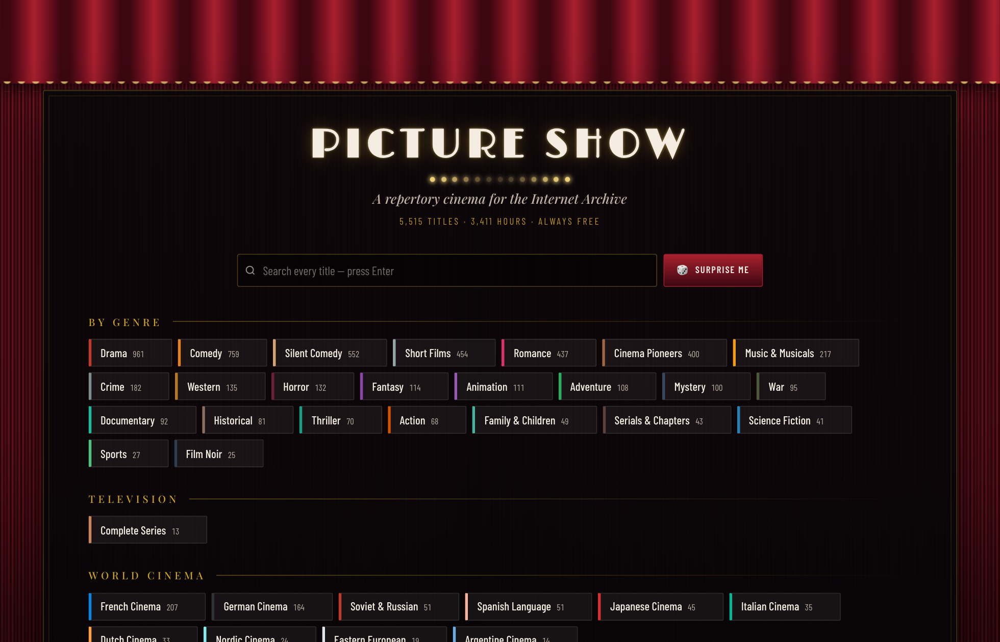
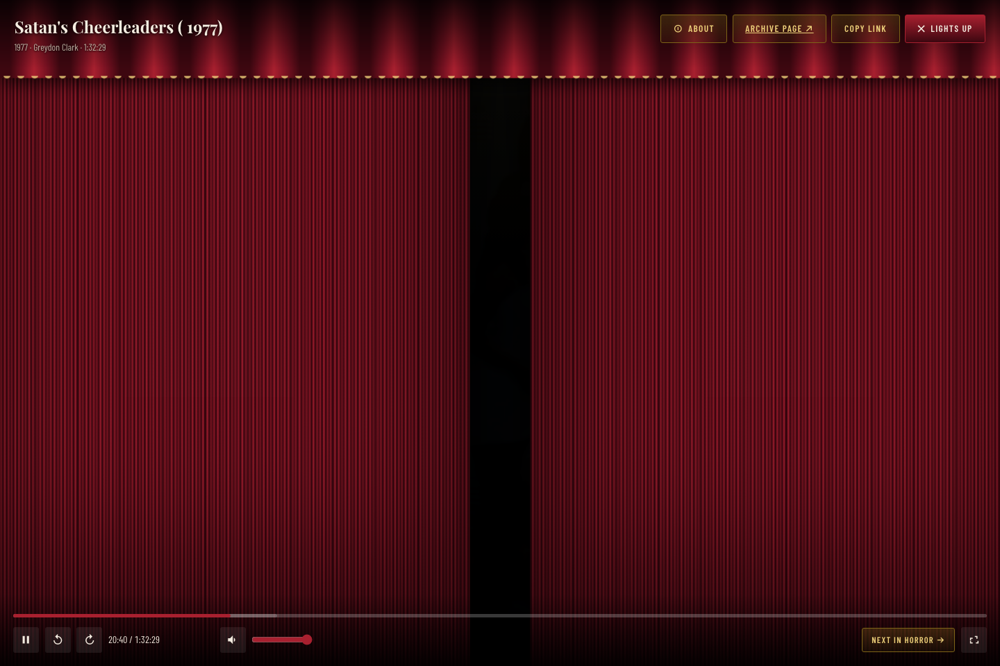
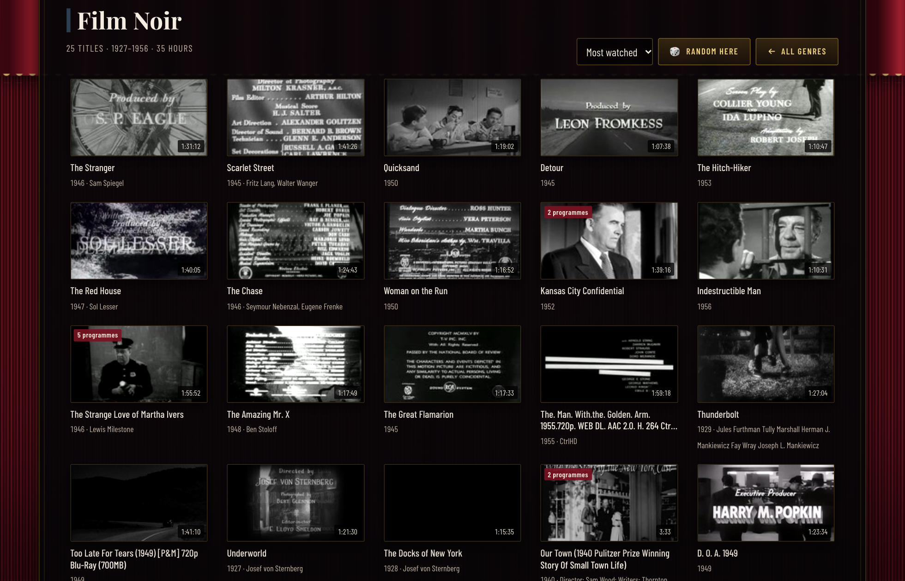

# Picture Show

**A repertory cinema for the Internet Archive.**

The Archive's [Feature Films](https://archive.org/details/feature_films) collection holds
tens of thousands of features — and browsing it is a chore. Picture Show
is a lobby for it: pick a genre, pick a title, the curtains part, and the film begins.
Nothing opens in a new tab.

Only pictures that are out of copyright in the United States are on the programme:
anything published 95 years ago or more (in 2026, everything from 1930 and before), and
the later films a sourced list says lost their copyright — *Night of the Living Dead*,
*His Girl Friday*, *Detour*, *Charade*, the Fleischer *Superman* cartoons. That rule is
applied to everything the pipeline looks at: [Feature Films](https://archive.org/details/feature_films),
the [Sci-Fi / Horror](https://archive.org/details/SciFi_Horror) selection, the television
and cartoon shelves, a handful of hand-picked items, and a sweep of the whole
[Moving Image Archive](https://archive.org/details/movies) for every English-language
feature and complete series on it. Most of what those shelves hold is still in copyright,
so most of it is not shown; the silent era is, nearly all of it.

**5,515 titles · 6,042 programmes · 48 ways in.** One self-contained HTML file.







## What it does

- **A real programme.** Every title is filed under headings — genres, television, world
  cinemas, forms and decades — derived from the Archive's own metadata by hand-written
  rules. Anything that defies filing lands in **The Vault**, so nothing is unreachable.
- **Curtains.** Choose a film and the velvet actually rolls back.
- **Every episode, not just the first.** An Archive item is often a whole serial in one
  upload — *Oswald the Lucky Rabbit* arrives as 57 cartoons under a single identifier. Pick
  one from the drawer (`e`), with its own runtime, its own resume point and its own link; `n`
  or the end of an episode rolls on to the next. 129 titles here hold more than one
  programme, 656 between them.
- **Random, everywhere.** A *Surprise me* button for the whole vault, a dice on every genre
  (shift-click a genre chip to jump straight into a random film from it), and *Random here*
  inside a genre.
- **It remembers.** Your place in a film is kept, so a half-watched picture resumes where you
  left it; watched titles show a progress bar in the grid.
- **Shareable.** Every genre, every film and every episode has its own link
  (`#/f/<archive-id>`, `#/f/<archive-id>/e/<episode>`), so you can send a friend straight to
  the picture.
- **The search box waits to be asked.** Type the whole title, then press Enter or hit the
  magnifier — nothing is searched while you are still typing. It used to run on a debounce
  from the second character up, which meant the whole catalogue was swept and the grid
  rebuilt between keystrokes, and the results were always a few letters behind your fingers.
- **Keyboard.** `/` search, `enter` to run it · `space` play/pause · `←/→` 10s (`shift` for a
  minute) · `↑/↓` volume · `f` fullscreen · `m` mute · `e` episodes · `n` next · `r` random ·
  `esc` lights up.

## Where the films come from

Everything streams **directly from archive.org**. This page stores no video, hosts nothing,
and proxies nothing — it is a menu with a projector attached. Each title links back to its
Archive item page, which is the authority on that film's rights and provenance.

The Internet Archive is a non-profit library that pays for all of the bandwidth this page
uses. If you get any pleasure out of this, [donate to them](https://archive.org/donate).

Picture Show plays what it lists, full screen, so it lists only what is out of copyright in
the United States — crediting a rights holder is not permission. The Archive's own licence
field is no help there: it is whatever the uploader chose, and *The Santa Clause 3* is
marked public domain. So a title is shown when it was published 95 years ago or more, or
when it is on Wikipedia's sourced
[list of public-domain films](https://en.wikipedia.org/wiki/List_of_films_in_the_public_domain_in_the_United_States)
(or [its animated counterpart](https://en.wikipedia.org/wiki/List_of_animated_films_in_the_public_domain_in_the_United_States)),
whose every entry cites why: not renewed, no notice, a US government work. Colorized prints
are never shown — the colour is a new work with its own copyright. A film in the public
domain can still carry a newer score or restoration, rights differ outside the US, and the
Archive's item page is always the last word. Posters, stills and metadata are the Archive's.

## Running it

`index.html` is a single self-contained file — the catalogue is baked in. Open it by
double-clicking, or serve the folder:

```sh
python3 -m http.server 8733
```

## Rebuilding the catalogue

`data/cinema-data.json` is committed, so `node build.mjs` alone rebuilds `index.html` on a
fresh clone. To regenerate the catalogue itself, the pipeline is five steps in `tools/`
(see `tools/README.md` for the details), and `node tools/pdlist.mjs` refreshes the
public-domain list the fourth one reads:

```sh
node tools/scrape.mjs      # page the Archive for every shelf, and the sweep's candidates
python3 tools/sweep.py     # sift the sweep: English, and a film or a series
node tools/resolve.mjs     # per item, record every playable encode  (slow: hours)
python3 tools/build.py     # keep what is out of copyright, classify, de-duplicate
node build.mjs             # inline the data into index.html
```

The shelves on the programme are the lists at the top of `tools/scrape.mjs`: `COLLECTIONS`
for an Archive collection, `UPLOADERS` for everything one account has uploaded, and `PICKS`
for individual items. Adding to any of them is enough to pull a shelf in; give it a heading
in `tools/taxonomy.py` if it deserves one.

Four things that pipeline gets right, and which are easy to get wrong:

- **An item is not a film.** The Archive names every derivative after the file it came from,
  so `S01E03.mp4`, `S01E03.ia.mp4` and `S01E03_512kb.mp4` are three encodes of one episode
  while `S01E04.ia.mp4` is a different programme. Group by that stem and an item's 4,629 files
  resolve into 2,401 episodes; don't, and 78,000 episodes have no way in. Only the Archive's
  own markers (`.ia`, `_512kb`, `_256kb`, `_64kb`) are stripped — a trailing `2`, `a` or
  `_ddcolor` is somebody's own file and gets its own row, because a false split shows a
  duplicate while a false merge hides a picture.

- **Prefer the Archive's own derivatives.** A file marked `source=original` is whatever the
  uploader had, often DivX or Xvid in an `.mp4` wrapper, and browsers refuse it outright.
  The Archive's generated encodes (`h.264 IA`, `512Kb MPEG4`) are always H.264 and always
  play. The player still falls back through the remaining encodes if the first one fails —
  and because the files are grouped first, every print in that chain is the same programme.
  It used to be "the next two files in the item", which on a series meant a decode failure
  quietly moved you to episode 2.
- **A bracket means something different on television.** De-duplication strips bracketed
  asides from a title, because on a feature they are noise — `White Zombie (1932)`,
  `Nosferatu [HD]`. On an episode the bracket *is* the identity: `(Episode 10)`,
  `(серия 2)`, `(April 21, 1984)`. Stripping those collapsed 179 distinct episodes into 8
  survivors, so a bracket is now only dropped when it holds nothing that tells one
  instalment from another.
- **No `crossorigin` on the video element.** `archive.org/download/...` answers with
  `access-control-allow-origin: *`, but the storage node it redirects to sends no CORS
  header at all — so any CORS-mode request dies. A plain media load is fine.

## Testing

Browser tests drive a headless Chrome over CDP (no npm dependencies):

```sh
python3 -m http.server 8733 &
"$CHROME" --headless=new --remote-debugging-port=9333 --user-data-dir=/tmp/picture-show-cdp &
node tools/smoke.mjs      # the whole lobby → genre → play → exit → search flow
node tools/playtest.mjs   # do the films actually decode?
node tools/epstest.mjs    # the episode picker, end to end
node tools/searchtest.mjs # the box stays quiet until it is submitted
```

The catalogue pipeline has its own tests, which need neither a browser nor the network:

```sh
node tools/rightstest.mjs # only what is out of copyright, on a fixture
node tools/dedupetest.mjs # classification and de-duplication rules, on a fixture
node tools/sweeptest.mjs  # the Moving Image Archive sweep's rules, on a fixture
node tools/progtest.mjs   # splitting an item's files into programmes
node tools/duptest.mjs    # a duplicates and rights audit of the catalogue actually built
```

## Credits

Built by [jtbartee](https://github.com/jtbartee). Films, posters and metadata courtesy of
the [Internet Archive](https://archive.org). The code here is MIT; the films are not mine
to license.
